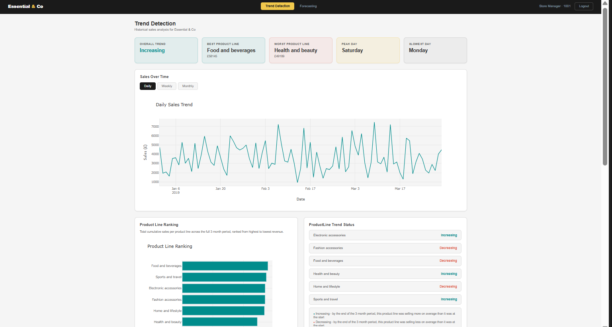
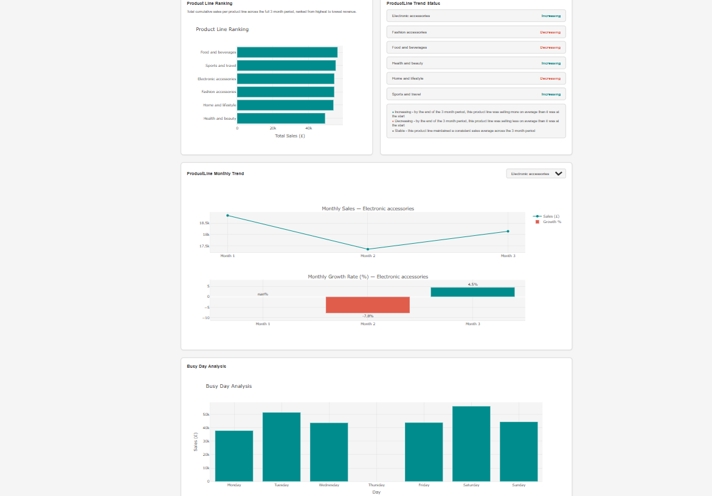
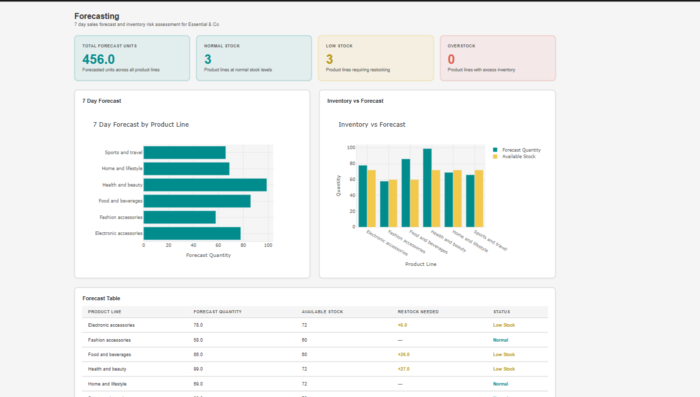
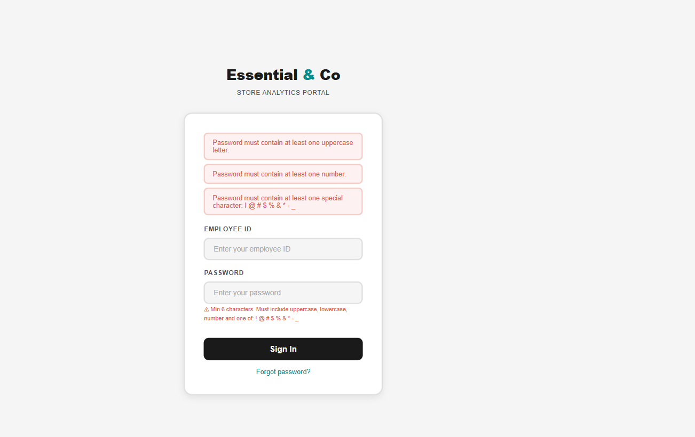
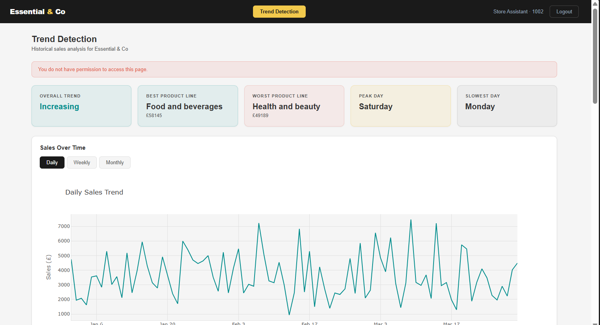

# Retail Analytics Dashboard for Brick-and-Mortar Stores

A Django web application that turns point-of-sale (POS) data into interactive dashboards for store managers and workers. It was built as my final year project in Computer Science at De Montfort University.

## Screenshots

### Trend detection dashboard



### Forecasting dashboard (store manager only)


### Login page with custom validation


### Role-based access control


## Problem

Brick-and-mortar stores generate a lot of transactional data, but often don't use it. Decisions about stock and replenishment tend to rely on past habits rather than evidence. Tools like Tableau and Power BI can be costly and hard to learn for small retailers. This project provides a simpler, open-source alternative.

## Features

**Trend Detection dashboard** (store manager and store worker)
- KPI cards showing key metrics at a glance
- Sales over time with daily, weekly and monthly views
- Product line ranking and trend status
- Busy-day (weekday) sales analysis
- Monthly product line trend chart with month-on-month growth and a product line filter

**Forecasting dashboard** (store manager only)
- 7-day demand forecast for every product line
- Inventory risk flags: low stock, normal stock and overstock
- Restock quantity for low-stock product lines

**Security**
- Login with employee ID and layered password validation
- Role-based access control using Django groups (principle of least privilege)
- Forecasting dashboard blocked for store workers, including direct URL access

## Tech stack

- **Python** and **pandas** for data cleaning and analysis
- **Django** (MVT architecture, built-in authentication, ORM)
- **SQLite** database
- **Plotly** for interactive charts
- **HTML, CSS and a little JavaScript** for the front end

## Architecture

The system has four layers:

1. **Data source:** supermarket sales CSV
2. **ETL pipeline:** `dataset_cleaning.py` (extract and transform) and `etl_load.py` (load into 10 database tables via the Django ORM)
3. **Application layer:** Django views query pre-computed results
4. **Presentation layer:** Django templates with Plotly charts

Heavy computation happens during ETL rather than at request time, which keeps the views lightweight.

## Method

- **Cleaning:** standardised column names, converted dates and times, checked for missing values and duplicates (none found), and used the IQR method for outliers. Nine high-value sales were kept as valid transactions.
- **Feature engineering:** extracted month, week, day of week, hour and year.
- **Trend analysis:** a 7-day rolling average, chosen to cover one full retail trading week.
- **Forecasting:** the latest 7-day rolling average of daily quantity per product line, multiplied by 7, compared against stock levels.

## Dataset

[Supermarket Sales dataset on Kaggle](https://www.kaggle.com/datasets/faresashraf1001/supermarket-sales) (Apache 2.0 licence): 1,000 transactions, 17 columns, three branches, January to March 2019.

The repository includes both the raw dataset (in `Dataset/`) and the cleaned output (`cleaned data.csv`), so you don't need to download anything to run the app.

**Note:** the dataset has no stock levels, so stock was generated synthetically (average quantity sold per product line x 12, approximating a 1-2 week replenishment cycle).

## Running locally (optional)

The screenshots above show the application. If you'd like to run it yourself:

### Requirements

- Python 3.11 or above
- pip package manager

### Setup

1. **Clone the repository:**

   ```bash
   git clone https://github.com/YOUR-USERNAME/YOUR-REPO.git
   cd YOUR-REPO
   ```

2. **Create and activate a virtual environment:**

   ```bash
   python -m venv venv
   # macOS / Linux
   source venv/bin/activate
   # Windows
   venv\Scripts\activate
   ```

3. **Install dependencies:**

   ```bash
   pip install -r requirements.txt
   ```

4. **Create the database:**

   ```bash
   python manage.py migrate
   ```

5. **Populate it with the ETL pipeline** (this reads the included `cleaned data.csv`):

   ```bash
   python etl_load.py
   ```

6. **Create an admin account:**

   ```bash
   python manage.py createsuperuser
   ```

7. **Start the server:**

   ```bash
   python manage.py runserver
   ```

8. **Create your users** by following the "Creating users" section below.

9. **Open the app** at http://127.0.0.1:8000 and log in.

The database file (`db.sqlite3`) is not included in this repository, so it is created in steps 4 and 5.

### Optional: re-run the data cleaning

`cleaned data.csv` is already included, so you can skip this. To regenerate it from the raw data:

```bash
python dataset_cleaning.py
```

The script reads `Dataset/Raw dataset/Retaildata/SuperMarket Analysis.csv` and overwrites `cleaned data.csv` in the project root. It uses paths relative to the script, so it works from any location. Two boxplot windows will open during the run. Close them to let the script finish.

## Creating users

The app has no built-in accounts, so you need to create your own. This takes about two minutes.

1. Make sure the server is running (`python manage.py runserver`).
2. Go to http://127.0.0.1:8000/admin/ and log in with the superuser you created in step 6.

### Step 1: Create the two groups

1. Under **Authentication and Authorization**, click **Groups**, then **Add group**.
2. Type the name `Store Manager` and click **Save**.
3. Repeat to create a second group named `Store Worker`.

The names must match exactly, including capital letters and the space.

### Step 2: Create a user

1. Click **Users**, then **Add user**.
2. Enter a username (this is the **Employee ID**, for example `1001`) and a password, then click **Save**.
3. On the next page, scroll to **Groups**, select `Store Manager` (or `Store Worker`), and move it to the **Chosen groups** box.
4. Click **Save**.

### Step 3: Log in

1. Go to http://127.0.0.1:8000.
2. Enter the Employee ID and password you just created.

### What each role sees

- **Store Manager:** both dashboards (trend detection and forecasting).
- **Store Worker:** the trend detection dashboard only.

### Password rules

The login page requires a minimum length, an uppercase and a lowercase letter, a number and a special character. For example, `Example#2026` would pass this check.

## Project structure

```
analytics/             Main app: models, views, URLs and templates
retail_analytics/      Django project settings and configuration
Dataset/               Raw supermarket sales data
cleaned data.csv       Cleaned dataset loaded by the ETL pipeline
dataset_cleaning.py    Data cleaning and transformation script
etl_load.py            ETL pipeline that populates the database
manage.py              Django entry point
requirements.txt       Project dependencies
quantity_boxplot.png   Outlier boxplot for quantity (cleaning step)
sales_boxplot.png      Outlier boxplot for sales (cleaning step)
docs/                  Screenshots
```

## Testing

Manual black-box UI testing with 42 test cases covering authentication, password validation, role-based access, dashboard navigation and filters. 37 passed and 5 were expected failures from negative password tests. There were no unexpected failures.

## Limitations

- Only three months of data, so long-term seasonality can't be captured
- Stock values are synthetic, so forecasts are indicative, not definitive
- Forecast accuracy was not formally evaluated (for example with MAE)
- No unit, performance or multi-user testing
- Transformation logic is duplicated across the cleaning and ETL scripts

## Future work

- Try ARIMA or SARIMA on a larger dataset and evaluate with MAE
- Self-service password reset
- Automated ETL triggering
- Move chart building out of views into helper functions

## Author

Rachel Adu, BSc Computer Science, De Montfort University (2026)
